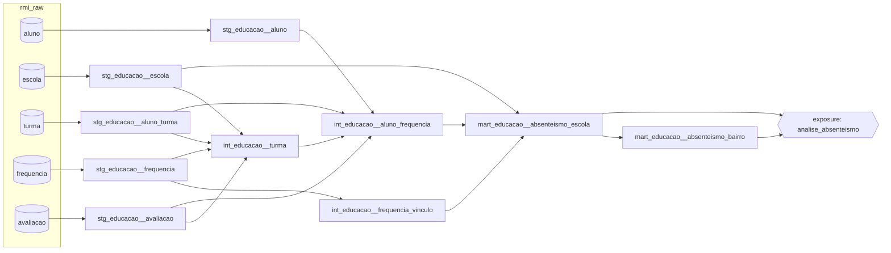

# Desafio RMI — Cientista de Dados (Prefeitura do Rio)

[](https://github.com/mmsb21/desafio-cientista-dados-peqc/actions/workflows/dbt.yml)

Projeto dbt sobre BigQuery que modela dados anonimizados da rede municipal de educação
do Rio de Janeiro, extraídos do RMI (Registro Municipal Integrado), com foco em
frequência escolar e absenteísmo crônico.

O enunciado original do desafio está em [ENUNCIADO.md](ENUNCIADO.md).

## Como reproduzir

**Pré-requisitos:** Python 3.13 com [uv](https://docs.astral.sh/uv/), Google Cloud CLI
e um projeto no BigQuery (o Sandbox, gratuito, é suficiente).

```bash
# 1. autenticação (é a credencial que o script de carga e o dbt usam)
gcloud auth application-default login
export GCP_PROJECT_ID=seu-projeto

# 2. ambiente Python (versões fixadas no uv.lock)
uv sync

# 3. carga dos Parquets de gs://case_vagas/rmi no dataset rmi_raw (location US)
uv run python scripts/load_raw.py

# 4. dbt
uv run dbt deps               # dbt_utils, dbt_expectations e codegen
uv run dbt debug              # testa a conexão
uv run dbt source freshness   # confere a atualização das fontes
uv run dbt build              # modelos e testes

# 5. documentação e lineage navegáveis (opcional)
uv run dbt docs generate && uv run dbt docs serve

# 6. notebook de análise exploratória (opcional; lê os Parquets localmente com DuckDB)
mkdir -p data && gcloud storage cp "gs://case_vagas/rmi/*" data/
uv run jupyter nbconvert --to notebook --execute --inplace notebooks/eda.ipynb
```

Para abrir o notebook no navegador: `uv run jupyter lab notebooks/eda.ipynb`.

Sem uv: `python -m venv .venv && .venv/bin/pip install -r requirements.txt`; depois, com
o ambiente ativado (`source .venv/bin/activate`), rode os mesmos comandos sem o `uv run`.

O `profiles.yml` fica na raiz do repositório e não guarda credenciais: o dbt usa a
credencial padrão do gcloud (passo 1) e lê o projeto da variável `GCP_PROJECT_ID`. Os
modelos são criados nos datasets `dbt_dev_staging`, `dbt_dev_intermediate` e
`dbt_dev_marts` (o prefixo `dbt_dev` pode ser trocado pela variável `DBT_DATASET`).

## Estrutura

```
├── .github/workflows/
│   └── dbt.yml         CI: dbt build a cada push e pull request no master
├── models/
│   ├── staging/        5 modelos (1 por tabela de origem), sources e testes
│   ├── intermediate/   3 modelos, testes e testes unitários
│   ├── marts/          2 modelos, contratos, testes e testes unitários
│   └── exposures.yml   a análise do README, ligada aos dois marts
├── tests/              testes de regra de negócio
├── analyses/           numeros_do_readme.sql: os números da análise, a partir dos marts
├── macros/             wilson_ic (intervalo de confiança de Wilson)
├── data/               Parquets baixados para o notebook (fora do git)
├── notebooks/
│   └── eda.ipynb       análise exploratória, com DuckDB sobre os Parquets de data/
├── scripts/
│   ├── load_raw.py             carga dos Parquets no BigQuery
│   ├── generate_sources.py     codegen: YAML das sources
│   ├── generate_staging.py     codegen: esqueletos dos modelos de staging
│   └── generate_model_yaml.py  codegen: YAML dos modelos
├── dbt_project.yml, packages.yml, profiles.yml
└── pyproject.toml, uv.lock, requirements.txt
```

## Lineage



A tabela pública `datario.dados_mestres.bairro` está declarada como source só para
documentação: o bairro chega como hash, e não há chave para juntar sem desfazer a
anonimização.

## Decisões

- **Fontes:** as 5 tabelas são carregadas sem transformação no dataset `rmi_raw` e
  declaradas como a source `educacao`. O esqueleto do YAML foi gerado com o codegen
  e completado com descrições, tipos reais e testes de contrato com a origem.
- **Materializações:** staging como view (1:1 com a fonte, sem custo de armazenamento);
  intermediate como view por padrão, com `table` só onde a agregação é pesada e
  reutilizada (`int_educacao__frequencia_vinculo` e `int_educacao__turma`, que leem a
  frequência inteira); marts como table, porque o BigQuery Sandbox não aceita DML e o
  modo incremental depende de MERGE.
- **Localização US:** a mesma da tabela pública `datario.dados_mestres.bairro`.

### Convenções de staging

- **Nomes:** modelos `stg_<source>__<tabela>` (ex.: `stg_educacao__aluno`); colunas em
  snake_case, com prefixo `id_` para identificadores. A tabela `turma` vira
  `stg_educacao__aluno_turma`, porque cada linha é o vínculo de um aluno com sua turma.
- **Identificadores como texto:** todos os ids são STRING, em todas as camadas. Na origem
  eles chegam com tipos diferentes (BYTES no id do aluno, INT64 nos demais) e não são
  números: padronizar evita junções entre tipos diferentes. O id do aluno é convertido
  com `to_hex` (17 bytes → 34 caracteres).
- **Tipos corrigidos só onde a origem errou:** datas gravadas como texto viram DATE e o
  bimestre, gravado como texto, vira INT64. Colunas que já chegam com o tipo certo
  (faixa etária, frequência, notas) não são convertidas.
- **Nomes que evitam confusão:** na frequência, o id do aluno vira `id_aluno_frequencia`,
  porque não identifica o mesmo aluno do cadastro, e a coluna `frequencia` vira
  `frequencia_bruta`, porque foi gravada sem o ×100.
- **Nulos:** mantidos quando são reais (ex.: bairro de residência ausente); o staging
  não inventa valores. A exceção é a nota de Inglês, que vem 100% nula e fica fora de
  `stg_educacao__avaliacao`.
- **Deduplicação:** só onde a origem repete a chave, com `dbt_utils.deduplicate` e a
  regra comentada no próprio modelo:
  - frequência: fica a linha de menor frequência, a de mais faltas, para não subestimar
    o absenteísmo;
  - avaliação: fica a linha com frequência preenchida e, entre elas, a de menor
    frequência; empate, a de menores notas.

### Intermediate

Três problemas só aparecem quando se cruzam as fontes, e cada modelo resolve um deles:

1. **A frequência foi gravada sem o ×100.** A origem calculou `100 − faltas/dias` em vez
   de `100 − 100 × faltas/dias`. Como `faltas/dias = 100 − frequencia`, a frequência
   certa sai da própria coluna: `100 − 100 × (100 − frequencia_bruta)`.
   `int_educacao__frequencia_vinculo` (tabela) aplica essa correção e calcula a
   frequência de cada vínculo (aluno da frequência × turma × escola) como a média simples
   dos registros (disciplina × período). Registros com mais faltas que dias, que dariam
   frequência negativa, ficam em 0 (0,07% dos registros).
2. **O id de aluno da frequência não identifica o mesmo aluno do cadastro.** Só 11 de
   105.934 pares (aluno, turma) da frequência existem na matrícula, e, aluno a aluno, a
   correlação com a frequência da avaliação é 0,00 (por turma, cerca de 0,7). Por isso a
   frequência só se liga às outras tabelas por turma e escola.
   `int_educacao__aluno_frequencia` faz o "alunos + matrículas + frequência" com a
   frequência da avaliação, usada como veio, onde o id é o do cadastro.
3. **A escola de uma turma só aparece na frequência.** `int_educacao__turma` (tabela)
   reúne as turmas das três fontes e traz a escola das que estão na frequência. As
   demais ficam com escola nula e marcadas: 12.544 de 18.060 turmas, quase todas de
   alunos mais novos. Um teste de `unique` garante que cada turma tem uma única escola.

| Modelo | Fontes | Join | Órfãos |
|---|---|---|---|
| `int_educacao__frequencia_vinculo` | frequência | nenhum: agrega a própria tabela | registros com mais faltas que dias ficam em 0 e são contados em `qtd_registros_limitados` |
| `int_educacao__turma` | frequência, matrícula, avaliação e escola | união das turmas das três fontes e `left join` | turmas fora da frequência ficam com escola nula e `tem_frequencia` falso |
| `int_educacao__aluno_frequencia` | avaliação, cadastro, matrícula e turma | `left join` | turma sem escola fica com escola nula; aluno avaliado fora da turma atual fica com `turma_da_matricula` falso |

**Médias simples:** sem o número de dias de cada período, cada mês (e, na avaliação,
cada bimestre) pesa igual na média. É uma aproximação documentada.

### Marts

- **`mart_educacao__absenteismo_escola`** (tabela, com contrato): responde "quais escolas
  têm a maior taxa de alunos com frequência abaixo de 75%", o mínimo da LDB. A unidade é o
  aluno na escola: as turmas do mesmo aluno na escola se juntam, e quem passou por duas
  escolas conta em cada uma.
  - **Intervalo de confiança de Wilson (95%),** pela macro `wilson_ic`: com escolas de
    tamanhos muito diferentes e taxas baixas, a taxa sozinha engana.
  - **Ranking** só entre escolas com 30 alunos ou mais, pelo limite inferior do
    intervalo, para uma escola pequena não subir por acaso.
  - **Referência:** a mesma taxa calculada com a frequência oficial da avaliação, no
    1º semestre, para as escolas que a avaliação alcança.
- **`mart_educacao__absenteismo_bairro`** (tabela, com contrato): a mesma medida por bairro
  da escola, construída a partir do mart por escola para que as duas leituras usem sempre
  a mesma definição. Um teste confere que os dois somam o mesmo número de alunos.
- **Contratos:** nos dois marts, nomes e tipos das colunas são conferidos antes de a tabela
  ser criada, e as colunas principais não aceitam nulo.

### Estratégia de testes

Cada camada testa o que pode quebrar nela:

- **Sources:** o contrato com a origem. Tipos reais (o id do aluno é BYTES; o bimestre é
  texto), valores aceitos e a premissa da fórmula da frequência (valores entre 90 e 100).
  As duplicatas da origem são monitoradas com `warn` acima de zero e `error` acima de um
  limite, porque são conhecidas e tratadas na staging.
- **Staging:** chaves e grão, com `unique`, `not_null`, `relationships` e `accepted_values`.
  Aqui o grão sem duplicatas é `error`, porque a staging já deduplicou.
- **Intermediate:** grão e premissas de join. O teste de `unique` em `int_educacao__turma`
  garante que cada turma tem uma única escola.
- **Marts:** contrato (nomes, tipos e colunas sem nulo) e coerência: o intervalo contém a
  taxa, só escolas com amostra suficiente entram no ranking, e os bairros somam os mesmos
  alunos que as escolas.
- **Regras de negócio** (testes singulares em `tests/`):
  - faltas não passam dos dias letivos do período;
  - a frequência corrigida concorda com a oficial da avaliação, por turma;
  - o id de aluno da frequência não é o do cadastro, a premissa que impede o join por aluno.
- **Testes unitários:** a correção do ×100 e o intervalo de Wilson, com entradas fixas e
  saída conhecida, independentes dos dados.

A justificativa de cada teste está no campo `description` do próprio YAML. Os `not_null`
sem descrição guardam chaves e colunas obrigatórias, pela regra da camada descrita acima.

No total são 91 testes de dados e 2 testes unitários. Para rodar uma parte só:
`dbt test -s test_type:singular`, `dbt test -s test_type:unit` ou `dbt build -s tag:marts`.

**Uma lição:** um `not_null` na coluna `frequencia` da tabela `frequencia` passava sempre,
porque o BigQuery lia `frequencia` como a linha inteira, que nunca é nula. O teste da
premissa usa `frequencia.frequencia` por isso. Um teste que passa não prova nada se não
testa a coisa certa.

### Integração contínua

O workflow `.github/workflows/dbt.yml` roda a cada push e pull request no `master`:
`dbt deps`, `dbt source freshness` e o `dbt build` completo, com modelos, testes de dados
e testes unitários.

- **Datasets separados:** o CI usa o prefixo `dbt_ci` (variável `DBT_DATASET`), então
  constrói tudo em `dbt_ci_staging`, `dbt_ci_intermediate` e `dbt_ci_marts`, sem tocar nos
  datasets de desenvolvimento.
- **Credencial:** uma conta de serviço só com os papéis `bigquery.jobUser` e
  `bigquery.dataEditor` no projeto. A chave fica apenas nos Secrets do GitHub
  (`GCP_SA_KEY`), e o `profiles.yml` é o mesmo do desenvolvimento: a action de
  autenticação aponta a credencial padrão do Google para a chave.
- **Reprodutível:** as dependências vêm do `uv.lock` (`uv sync --locked`, sem as do
  notebook), as actions estão fixadas pelo hash do commit, e só roda uma execução por
  vez, para duas não escreverem nos mesmos datasets.
- **Limite do Sandbox:** as tabelas expiram em 60 dias. Depois disso, o `rmi_raw` deixa
  de existir e o CI falha até a carga ser refeita com `scripts/load_raw.py`.

## Análise dos resultados

**Pergunta:** quais escolas e regiões têm a maior taxa de alunos com frequência abaixo de
75%, o mínimo da LDB?

**Base:** 100.640 alunos em 521 escolas, nas turmas cobertas pela tabela de frequência
(alunos de 11 a 17 anos), no período que ela cobre (fevereiro a outubro, quase tudo até
julho).

1. **A taxa da rede é baixa: 3,1%** (3.119 alunos abaixo de 75%). Entre as 475 escolas com
   30 alunos ou mais, a mediana é 1,8%, uma em cada dez fica acima de 7,4%, e a maior chega
   a 25,4%.
2. **O problema é concentrado.** Nessas 475 escolas, 120 não têm nenhum aluno abaixo de
   75%. As 47 com as maiores taxas (10%) têm 9,7% dos alunos, mas um terço dos alunos
   abaixo de 75%; seguindo a mesma ordem, 83 escolas respondem pela metade deles. Uma ação
   concentrada em poucas escolas alcança a maior parte do problema.
3. **O ranking leva em conta a incerteza.** 89 escolas ficam acima da taxa da rede com 95%
   de confiança. As cinco primeiras, ordenadas pelo limite inferior do intervalo:

   | Posição | Escola (hash) | Alunos | Abaixo de 75% | Taxa | IC 95% |
   |---|---|---|---|---|---|
   | 1 | -289678930… | 337 | 80 | 23,7% | 19,5% a 28,6% |
   | 2 | 7313141713… | 59 | 15 | 25,4% | 16,1% a 37,8% |
   | 3 | -161769914… | 201 | 39 | 19,4% | 14,5% a 25,4% |
   | 4 | 1864000683… | 192 | 37 | 19,3% | 14,3% a 25,4% |
   | 5 | 4399301626… | 49 | 11 | 22,4% | 13,0% a 35,9% |

   A escola 2 tem taxa maior que a 1, mas fica atrás: com 59 alunos, o intervalo é largo
   e não dá para afirmar com a mesma segurança que ela está tão acima da rede.
4. **A escola pesa mais que o território.** Da variação da frequência entre alunos, 14,9%
   está entre escolas e só 4,2% entre os bairros onde elas ficam. Metade dos 135 bairros
   tem no máximo 2 escolas com dados, e os quatro primeiros do ranking por bairro têm uma
   escola só. O foco da ação deve ser a escola; o bairro é uma leitura complementar.
5. **A frequência oficial confirma a ordem.** Nas 363 escolas com 30 alunos ou mais nas
   duas fontes, a taxa corrigida e a da avaliação têm correlação de 0,67. O nível da
   oficial é mais alto (5,2% contra 3,1%), por isso ela entra como referência, não como
   substituta.
6. **Por que importa:** na avaliação, alunos abaixo de 75% de frequência no bimestre têm
   nota média de 3,45; entre 90% e 99%, de 6,35. Aluno a aluno, a correlação entre
   frequência e nota é de 0,45 a 0,48 nos dois primeiros bimestres.
7. **O que não se confirmou:** o tamanho da turma não tem relação com a nota (correlação de
   −0,05 entre 1.300 turmas e de 0,01 dentro da mesma escola). Isso não prova que o
   tamanho não importa: não há o tamanho real da turma (a matrícula é uma amostra), nem
   série, turno ou dado de professor, e o tamanho da turma não é aleatório.

Os números saem de [`analyses/numeros_do_readme.sql`](analyses/numeros_do_readme.sql), que
consulta os marts (`uv run dbt show -s numeros_do_readme --output json`), e do
[notebook de análise exploratória](notebooks/eda.ipynb), que reproduz os itens 4, 6 e 7.

**Limites:** os dados são anonimizados e aleatorizados, então os números ilustram o método
e não descrevem a rede real. A frequência cobre só alunos de 11 a 17 anos, a escola só é
conhecida pela frequência, e as médias são simples, sem o peso dos dias de cada período.

## Análise exploratória

O notebook [`notebooks/eda.ipynb`](notebooks/eda.ipynb) mostra os achados nos dados que
orientaram as decisões do projeto, cada um com a consulta, o resultado e a decisão tomada:

1. tipos diferentes do schema fornecido;
2. chaves repetidas na frequência e na avaliação;
3. a frequência gravada sem o ×100;
4. o id de aluno da frequência, que não identifica o mesmo aluno do cadastro;
5. a cobertura da frequência e a escola, que só aparece nela;
6. os bairros, sem chave comum entre os dois cadastros.

A seção 7 reproduz os itens 4, 6 e 7 da análise, e a 8 resume cada achado com a decisão
correspondente. O notebook lê os Parquets localmente com DuckDB, sem gastar cota do
BigQuery, e reaplica as regras da staging e da intermediate (ids em texto, deduplicação e
correção do ×100). Por isso chega aos mesmos números dos marts, como a taxa de 3,1% e as 89
escolas acima da rede.

## Trade-offs

- **Médias simples em vez de ponderadas.** Sem o número de dias de cada período, cada mês
  (e cada bimestre, na avaliação) pesa igual. Fica simples e usa só o que os dados trazem,
  ao custo de uma pequena distorção nos períodos curtos.
- **Frequência corrigida como medida principal, a oficial como referência.** A tabela de
  frequência traz a escola em cada registro e o dobro de alunos por escola; a oficial
  cobre o ano todo, mas só chega à escola pela turma. Usar as duas mostra onde concordam.
- **Nenhum join por aluno com a frequência.** É a decisão correta para estes dados, mas
  perde o vínculo aluno a aluno entre a frequência corrigida e a idade, o bairro de
  residência e a nota. Essas análises usam a frequência da avaliação.
- **Cobertura parcial.** A escola só é conhecida para as turmas da frequência: o mart
  cobre 521 das 1.558 escolas do cadastro, e só alunos de 11 a 17 anos.
- **Staging em view.** Fica sempre atualizada e sem custo de armazenamento, mas cada
  consulta refaz a deduplicação da frequência. O custo fica concentrado nas duas tabelas
  da intermediate.
- **Tabela em vez de incremental nos marts.** O Sandbox não permite MERGE, e com 521
  linhas reconstruir tudo leva segundos.
- **Corte de 30 alunos para o ranking.** É um limite simples e documentado; o intervalo
  de Wilson mostra a incerteza de todas as escolas, inclusive as que ficam de fora.
- **Chave de conta de serviço no CI.** É o jeito mais simples de autenticar o GitHub no
  BigQuery. A conta só acessa o BigQuery do projeto e a chave fica nos Secrets, mas é uma
  credencial de longa duração.
- **Testes com tolerância.** Os testes de regra de negócio aceitam o resíduo conhecido e
  falham quando ele cresce. Isso evita um teste sempre vermelho, mas os limites precisam
  ser revistos se a origem mudar.

## O que faria com mais tempo

- **Calendário letivo oficial da SME,** para ponderar cada período pelos dias letivos em
  vez de usar médias simples.
- **Contrato de dados com a origem,** para corrigir a fórmula da frequência e o mapeamento
  dos ids de aluno. Com os ids certos, a frequência passaria a se ligar ao aluno.
- **Série, turno e tamanho real da turma,** para responder a segunda pergunta do enunciado
  (desempenho por perfil de turma) com os controles que faltam hoje.
- **Estimativas com encolhimento (empirical Bayes)** para as taxas de escolas pequenas, no
  lugar do corte de 30 alunos.
- **Particionamento e modelos incrementais** num projeto fora do Sandbox, se a carga
  passar a ser diária.
- **CI sem chave e só do que mudou:** autenticação por Workload Identity Federation, no
  lugar da chave, e seleção `state:modified+` com `--defer`, para construir apenas os
  modelos alterados quando o projeto crescer.
- **Painel sobre os marts** (por exemplo, no Looker Studio).

## Diferenciais

- **Pacotes:** `dbt_utils` (deduplicação, grão, expressões), `dbt_expectations` (faixas,
  tipos, comparação entre tabelas) e `codegen` (esqueletos de sources, modelos e YAML,
  gerados pelos scripts em `scripts/`).
- **Freshness** na source `educacao`, pensada para um extrato anual: avisa depois de 365
  dias e falha depois de 400.
- **Tags** por camada, para rodar uma camada só: `dbt build -s tag:marts`.
- **Exposure** da análise do README (`models/exposures.yml`), ligada aos dois marts: ela
  aparece no lineage do `dbt docs`, e `dbt build -s +exposure:analise_absenteismo`
  constrói e testa tudo de que a análise depende.
- **Contratos** nos dois marts.
- **Testes unitários** e uma **macro própria** (`wilson_ic`).
- **Notebook de análise exploratória,** que roda localmente com DuckDB e reproduz parte da
  análise.
- **CI com GitHub Actions:** `dbt build` completo a cada push, em datasets separados e com
  a credencial só nos Secrets do GitHub.
